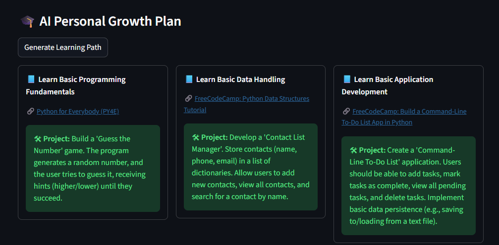

# Smart Resume Analyzer

[](https://github.com/kanishk2705/Smart-Resume-Analyzer/actions/workflows/ci.yml)

Scores a resume against a job description, explains the score requirement by requirement,
shows which skills are matched or missing, and uses an LLM to suggest how to close the gaps.



## Why

Keyword-based applicant tracking systems reject candidates over wording: a resume that says
"built dashboards" can miss a job description asking for "data visualization". This project
compares the two documents by meaning as well as by keyword.

## Features

- **Score breakdown** — an overall match score built from four components (skills,
  requirement coverage, experience relevance, education), each shown with its own score,
  weight and a one-line explanation.
- **Skill gap by category** — every skill the job asks for is marked matched, related
  (the resume has a substitute, e.g. MySQL for PostgreSQL) or missing.
- **Requirement coverage** — each sentence of the job description is paired with the resume
  sentence that supports it best, and rated strong, partial or weak.
- **Section-aware parsing** — the resume is split into Experience, Education, Skills,
  Projects and other sections, including resumes laid out as Word tables.
- **ATS format check** — ten checks on the resume itself: contact details that exist only
  as hyperlinks, icons that extract as junk, missing standard sections, length,
  unquantified or passive bullet points, and first-person pronouns.
- **Recruiter mode** — upload up to 25 resumes and rank them against one job description,
  with a CSV export. An unreadable file is reported and skipped, not fatal to the batch.
- **History** — every analysis is saved to SQLite, with the change in score since the
  previous analysis for the same job, so you can see whether an edit helped.
- **PDF report** — any analysis can be downloaded as a formatted report.
- **AI learning path** — Google Gemini suggests a learning resource and a project idea for
  the top missing skills.
- **REST API** — everything the UI does is available over HTTP, with interactive docs.

## How scoring works

The resume and the job description are both split into sentence-sized units (one per
bullet point or sentence). Each unit is embedded with SBERT (`all-MiniLM-L6-v2`), and every
resume unit is compared with every job description unit by cosine similarity. Embedding
units, not whole documents, means the entire resume is read; the model itself only reads
256 tokens at a time.

| Component            | Weight | How it is computed                                                                                   |
| -------------------- | ------ | ---------------------------------------------------------------------------------------------------- |
| Skills match         | 40%    | Share of the job's skills found in the resume. A related skill earns half credit.                    |
| Requirement coverage | 30%    | For each job requirement, the best-matching resume unit; averaged over all requirements.             |
| Experience relevance | 20%    | The five Experience / Projects statements that best match the job; averaged.                         |
| Education            | 10%    | 100 if the resume's highest degree meets the job's minimum, 50 if one level short, otherwise 0.      |

The overall score is the weighted mean. A component that cannot be assessed (for example,
the job states no degree requirement) is left out and the remaining weights are
renormalised, so it is not counted as zero.

Skills come from a hand-curated taxonomy of about 190 skills in
[core/data/skills.json](core/data/skills.json). Each entry lists its spellings, and matching
respects symbols and case, so `C++`, `C#`, `CI/CD` and `S3` are recognised and "excellent"
is not read as Excel.

Raw cosine similarities are stretched onto 0–100 between a floor (0.15) and a ceiling
(0.70), because unrelated sentences rarely score 0 and paraphrases rarely score 1.

## Architecture

```text
┌──────────────────┐   HTTP    ┌────────────────────┐   HTTPS   ┌────────────┐
│ Streamlit UI     │ ────────▶ │ FastAPI backend    │ ────────▶ │ Gemini API │
│ frontend/ :8501  │           │ backend/     :8000 │           └────────────┘
└──────────────────┘           │   └─ core/         │
                               │      parsing       │
                               │      sections      │
                               │      skills        │
                               │      scoring       │
                               └────────────────────┘
```

The frontend holds no ML code and talks to the backend only over HTTP. `core/` has no web
framework code, so it can be tested and reused on its own.

```text
├── core/                  # Analysis logic, independent of any web framework
│   ├── config.py          # Settings from environment variables / .env
│   ├── parsing.py         # PDF and DOCX text extraction
│   ├── sections.py        # Splits resumes and job descriptions at section headings
│   ├── text.py            # Splits text into sentence-sized units
│   ├── skills.py          # Skill extraction against the taxonomy
│   ├── education.py       # Degree level detection
│   ├── scoring.py         # Score components and explanations
│   ├── ats.py             # Format checks on the resume itself
│   ├── report.py          # PDF report
│   ├── data/skills.json   # Skill taxonomy
│   └── recommendations.py # Gemini client with model fallback
├── backend/               # FastAPI service
│   ├── main.py            # Routes and error handling
│   ├── storage.py         # Analysis history (SQLite)
│   ├── schemas.py         # Request / response models
│   └── Dockerfile
├── frontend/              # Streamlit client
│   ├── app.py
│   ├── api_client.py
│   └── Dockerfile
├── tests/                 # pytest suite
├── requirements/          # Pinned dependencies (backend, frontend, dev)
├── docker-compose.yml
└── .github/workflows/     # CI: lint + tests on every push
```

## Run with Docker

```bash
docker compose up --build
```

Then open <http://localhost:8501>. The API docs are at <http://localhost:8000/docs>.

The first build downloads PyTorch and the embedding model, so it takes a few minutes.

To enable the AI learning path, copy `.env.example` to `.env` and set `GEMINI_API_KEY`
before starting. Without it, the UI asks for a key when you use that feature.

## Run locally

Requires Python 3.11 or newer.

```bash
pip install -r requirements.txt

# Terminal 1: backend
uvicorn backend.main:app --reload

# Terminal 2: frontend
streamlit run frontend/app.py
```

The frontend looks for the backend at `http://localhost:8000`. Set the `BACKEND_URL`
environment variable to point it elsewhere.

## API

| Method | Path                          | Description                                          |
| ------ | ----------------------------- | ---------------------------------------------------- |
| GET    | `/health`                     | Service status and configuration                     |
| POST   | `/api/v1/analyze`             | Score one resume against a JD and save the result    |
| POST   | `/api/v1/rank`                | Rank several resumes against one JD (not saved)      |
| GET    | `/api/v1/history`             | Summaries of past analyses, newest first             |
| GET    | `/api/v1/history/{id}`        | One past analysis in full                            |
| GET    | `/api/v1/history/{id}/report` | That analysis as a PDF                               |
| DELETE | `/api/v1/history/{id}`        | Delete a past analysis                               |
| POST   | `/api/v1/recommendations`     | Learning resources and projects for missing skills   |

```bash
curl -X POST http://localhost:8000/api/v1/analyze \
  -F "resume=@resume.pdf" \
  -F "job_description=We are hiring a data analyst skilled in SQL and Python."
```

```json
{
  "match_score": 64.11,
  "components": [
    {"key": "skills", "label": "Skills match", "score": 63.64, "weight": 0.4,
     "detail": "6 of 11 required skills found, 2 more covered by a related skill."}
  ],
  "skills": [
    {"name": "Python", "category": "Programming Languages", "status": "matched", "related_to": null},
    {"name": "PostgreSQL", "category": "Databases", "status": "related", "related_to": "MySQL"},
    {"name": "Airflow", "category": "Data Engineering & BI", "status": "missing", "related_to": null}
  ],
  "additional_skills": ["R", "Pandas", "Git"],
  "requirements": [
    {"requirement": "Build and maintain dashboards that track key business metrics.",
     "evidence": "Built interactive dashboards in Tableau and Power BI used by 40 store managers.",
     "similarity": 0.57, "status": "strong"}
  ],
  "top_sentences": [
    {"text": "Built interactive dashboards in Tableau and Power BI used by 40 store managers.", "score": 0.57}
  ],
  "sections_found": ["summary", "experience", "projects", "education", "skills"],
  "ats": {
    "score": 70.0,
    "checks": [
      {"key": "email", "label": "Email address", "status": "warn",
       "message": "Email address exists only as a hyperlink, not as visible text. ...",
       "examples": []}
    ]
  }
}
```

The response above is shortened; the full schema is in the interactive docs.

## Configuration

All settings are optional and read from environment variables or a `.env` file.

| Variable          | Default                      | Purpose                                      |
| ----------------- | ---------------------------- | -------------------------------------------- |
| `GEMINI_API_KEY`  | *(empty)*                    | Enables the AI learning path                 |
| `GEMINI_MODELS`   | see `.env.example`           | Models to try, in order                      |
| `EMBEDDING_MODEL` | `all-MiniLM-L6-v2`           | Sentence-transformers model used for scoring |
| `MAX_UPLOAD_MB`   | `5`                          | Largest accepted resume file                 |
| `MAX_BATCH_FILES` | `25`                         | Most resumes ranked in one request           |
| `HISTORY_DB`      | `data/history.db`            | SQLite file holding past analyses            |
| `LOG_LEVEL`       | `INFO`                       | Backend log verbosity                        |
| `BACKEND_URL`     | `http://localhost:8000`      | Where the frontend finds the API             |

Component weights and similarity thresholds can be changed the same way; see
[core/config.py](core/config.py) for the full list.

## Development

```bash
pip install -r requirements/dev.txt

ruff check .              # lint
pytest -m "not slow"      # fast tests, no model download
pytest                    # all tests, including one that loads the real model
```

## Known limitations

- **The score is not validated against hiring outcomes.** The component weights, the
  similarity floor and ceiling, and the strong / partial thresholds were chosen by
  inspecting a handful of examples, not fitted to labelled data. Treat the score as a
  relative guide, not a probability of getting an interview.
- **The skill taxonomy is hand-curated and tech-focused.** A skill that is not in
  `skills.json` is invisible to the skills component, and "related" skills are limited to
  the substitute groups defined there.
- **Single-letter languages are matched conservatively.** `C`, `R` and `Go` only count
  when they appear in a delimited list such as "Python, R, Go", not in running prose.
- **Section detection depends on conventional headings.** A resume with unusual headings
  is scored as one block, and its experience component is reported as not assessed.
- **Every sentence of the job description counts as a requirement**, apart from sections
  headed "About us", "Benefits" and similar. Boilerplate elsewhere lowers coverage.
- **Education is judged on degree level only**, not field of study or institution.
- **ATS checks are rules of thumb.** They flag common problems; they do not reproduce the
  behaviour of any particular applicant tracking system.
- **There are no user accounts.** Anyone who can reach the app sees the whole history.
  The history holds analysis results (including sentences quoted from resumes), not the
  uploaded files. Run it locally or behind your own access control.
- Multi-column PDF layouts can be extracted out of reading order, and scanned
  (image-only) PDFs are not supported.
- English only.

## Roadmap

- [x] Phase 1: NLP keyword matching (NLTK)
- [x] Phase 2: Semantic matching and hero sentences (SBERT)
- [x] Phase 3: Docker
- [x] Phase 4: LLM learning paths (Gemini)
- [x] v2, step 1: FastAPI backend, separate frontend, tests, CI, pinned dependencies
- [x] v2, step 2: Section-aware parsing, sentence-level scoring, score breakdown, skill
      taxonomy (replaces the Phase 1 keyword matcher)
- [x] v2, step 3: Recruiter mode, ATS format checker, analysis history, PDF report
- [ ] Evaluate the score against labelled resume–job pairs and fit the weights to data
- [ ] Hosted demo

Earlier phases: [1](assets/phase_1_demo.png) · [2](assets/phase_2_demo.png) ·
[3](assets/phase_3_demo.png) · [4](assets/phase_4_demo.png)

---

Built by A C Kanishk.
